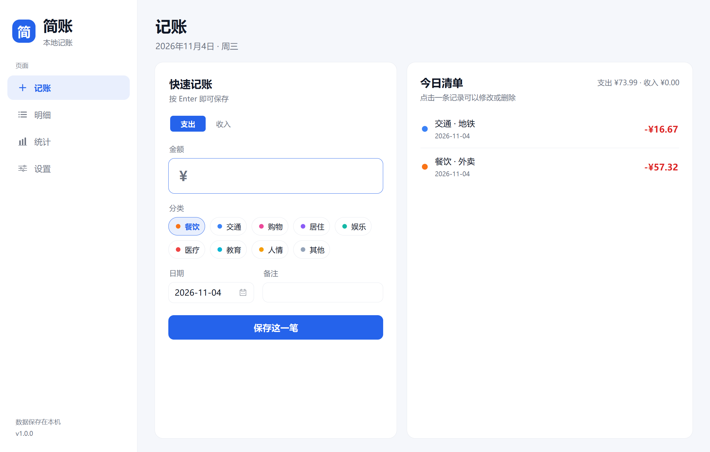

# 简账 · ZhaoZhaoRecord

一款轻量的 Windows 桌面记账应用：Python + Tkinter + SQLite 构建，界面简约，默认蓝白主题，数据全部保存在本机。



## 下载与运行

- **直接使用（推荐）**：从 [GitHub Releases](https://github.com/pzr-Ryan/ZhaoZhaoRecord/releases) 下载 `ZhaoZhaoRecord.exe`，双击运行，无需安装 Python。
- 也可以下载 `ZhaoZhaoRecord-1.0.0-win64.zip`，解压后运行其中的 exe。
- 首次运行会自动创建数据库和默认分类，位置为 `%LOCALAPPDATA%\ZhaoZhaoRecord\data\ledger.db`。
- **提示“Windows 已保护你的电脑”**：exe 目前未做代码签名，从网络下载后首次运行会触发 SmartScreen。点“更多信息 → 仍要运行”即可；想让本机以后不再提示，右键 exe → 属性 → 勾选“解除锁定”。彻底消除提示需要受信任的代码签名证书，选型与内置签名脚本见 [docs/signing.md](docs/signing.md)。
- 便携用法：`ZhaoZhaoRecord.exe --db D:\我的账本\ledger.db`，可把数据库放到任意目录。

### 从源码运行

需要 Windows + Python 3.9 及以上（Tkinter 随官方 Python 安装，无需 pip 安装依赖）。

```bat
git clone https://github.com/pzr-Ryan/ZhaoZhaoRecord.git
cd ZhaoZhaoRecord
```

- 双击 `启动记账.vbs`（无控制台窗口）。
- 调试：双击 `启动记账.bat`，出错时窗口会保留并显示原因。
- 命令行：

  ```bat
  cd /d ZhaoZhaoRecord
  python main.py
  ```

## 功能

- **快速记账**：金额、支出/收入、分类、日期、备注，按 Enter 或点“保存这一笔”立即入账；右侧“今日清单”可点击修改或删除。
- **明细筛选**：今日 / 本月 / 本年 / 全部 / 自定义日期范围；按类型、分类、关键词筛选；表格支持双击或 Enter 编辑、Delete 删除；实时合计收入、支出与结余。
- **统计视图**：今日、本月、本年支出卡片；近 14 天 / 近 12 月 / 近 5 年支出柱状图（悬停显示金额）；本月支出分类环形图；本月收入、支出、结余、日均支出、最大单笔概览。
- **主题颜色**：蓝白（默认）、青碧、紫罗兰、暖橙、玫瑰、墨青 6 套预设，支持自定义取色；切换立即生效并记住。
- **分类管理**：支出 / 收入分类可新增、改名、换色、删除；有记录的分类会阻止删除并提示。
- **数据自主**：CSV 导出（UTF-8 BOM，Excel 可直接打开）、一键备份数据库、打开数据目录。
- **细节**：Ctrl+1..4 切换页面；窗口大小与位置记忆；高 DPI 屏幕按真实像素渲染；Toast 提示与空状态引导。

更多界面：[明细](docs/screenshots/page_transactions.png) · [统计](docs/screenshots/page_stats.png) · [设置](docs/screenshots/page_settings.png)

## 数据与备份

- 源码运行：数据库在 `data\ledger.db`，日志在 `data\app.log`。
- exe 运行：数据库在 `%LOCALAPPDATA%\ZhaoZhaoRecord\data\ledger.db`，日志在同目录的 `app.log`。
- SQLite WAL 模式；金额以“分”为整数存储，避免浮点误差。
- 设置页 → “备份数据库”会在你选择的位置生成完整副本；恢复时退出应用，用备份替换数据库文件即可。
- “导出 CSV”导出全部记录，字段为日期、类型、分类、金额、备注；以 `= + - @` 开头的备注会加单引号，避免被表格软件当作公式执行。

## 快捷键

| 快捷键 | 作用 |
| --- | --- |
| `Ctrl+1` / `2` / `3` / `4` | 切换到 记账 / 明细 / 统计 / 设置 |
| `Enter`（金额或备注框） | 保存当前一笔 |
| `Enter` / 双击（明细行） | 编辑选中记录 |
| `Delete`（明细行） | 删除选中记录 |
| `Esc`（对话框） | 关闭对话框 |

命令行参数：`--db 路径` 指定数据库；`--demo` 使用演示数据（自动生成最近 3 个月约 240 条）；`--page` 指定启动页（record/transactions/stats/settings 或 1..4）。

## 主题与分类

- 主题：设置页顶部色块，点击即切换；自定义颜色单独记忆。
- 默认支出分类：餐饮、交通、购物、居住、娱乐、医疗、教育、人情、其他。
- 默认收入分类：工资、奖金、理财、兼职、其他。
- 分类颜色同步用于记账页标签、明细分类、统计环形图和设置页列表。

## 开发与验证

```bat
cd /d ZhaoZhaoRecord
python -m unittest discover -s tests -v
python verify/tour.py            :: 演示数据逐页截图到 verify/out
python verify/verify_flows.py    :: 保存/筛选/删除/导出/备份/主题/窗口记忆
python verify/tour_min.py        :: 最小窗口 1000x640 下的四页截图
```

本项目不依赖任何第三方 Python 包；截图工具使用 Windows GDI（`ctypes`）与自写 PNG 编码。

### 打包 Windows exe

```powershell
powershell -ExecutionPolicy Bypass -File packaging\build.ps1
```

脚本会把 PyInstaller 安装到 `.tools\pyinstaller`（不污染全局 Python），生成：

- `dist\ZhaoZhaoRecord.exe`：onefile、无控制台窗口，内嵌图标与版本信息 1.0.0；
- `dist\SHA256SUMS.txt`：发布附件的 SHA-256 校验值。

需要签名的发布版，先取得代码签名证书，再用 `-Sign` 让构建在压缩前完成 Authenticode 签名（SHA-256 + RFC 3161 时间戳）：

```powershell
powershell -ExecutionPolicy Bypass -File packaging\build.ps1 -SkipInstall -Sign -PfxPath C:\keys\zhao.pfx
```

也可用 `-CertThumbprint` 指定当前用户证书存储中的证书；签名细节见 [docs/signing.md](docs/signing.md)。

图标可用 `packaging\make_icon.ps1` 重新生成；版本资源在 `packaging\version_info.txt`，PyInstaller 配置在 `packaging\ZhaoZhaoRecord.spec`。

## 项目结构

```text
记账本/
  main.py                 程序入口
  ledger/
    app.py                窗口外壳、导航、主题重建、启动参数、应用数据路径
    db.py                 SQLite 存取层（分类、记录、统计、导出、备份）
    money.py              金额解析与格式化（以分为单位）
    dates.py              日期区间工具
    theme.py              配色、DPI 缩放、ttk 样式
    widgets.py            自绘卡片/按钮/标签/下拉/日历/滚动区/Toast 等
    charts.py             柱状图与环形图（Canvas 自绘）
    raster.py             无 Pillow 的抗锯齿图形渲染与缓存
    motion.py             缓动曲线与转场时长常量
    snapshot.py           Windows GDI 页面截图（切页转场用）
    dialogs.py            记账、分类对话框
    demo.py               演示数据生成
    views/                记账 / 明细 / 统计 / 设置 四个页面
  tests/                  数据层、主题与路径单元测试
  packaging/              exe 打包、版本信息与图标脚本
  docs/screenshots/       README 界面截图
  verify/                 截图与端到端验证脚本
```

## 更新与修复

### 1.1.0（开发中）

**新增**

- **页面切换转场**：切页时先截取当前页，用无边框窗口把它从 1.0 线性淡出到 0（1000ms）；淡出到 75% 时新页从下方滑入，总时长 2150ms。截图失败或非 Windows 平台自动回退纯色幕布（`ledger/motion.py`、`ledger/snapshot.py`）。
- **自绘控件体系**：`NavItem` 左栏导航（图标 + 悬停态）、圆角卡片与统计卡、圆角窗口、自定义下拉框与日期选择器（含日历弹层）、圆角输入框与金额框、胶囊分段器、链接式按钮 `LinkLabel`（`ledger/widgets.py`）。
- **无 Pillow 的抗锯齿绘制**：新增 `ledger/raster.py`，圆角矩形 / 圆环 / 圆形以上采样 + 盒式滤波生成 PNG，经 `tk.PhotoImage` 显示，并按尺寸和颜色缓存；图表与图标在高 DPI、任意窗口尺寸下都保持平滑。
- **图表视觉升级**：柱状图改为渐变圆角柱并带数值气泡，环形图增加缎带与高光，悬浮提示同步重绘。
- **代码签名流水线**：`packaging\build.ps1` 新增 `-Sign`、`-PfxPath`、`-PfxPassword`、`-CertThumbprint`、`-TimestampUrl`（默认 DigiCert RFC3161 时间戳），签名在压缩 zip 之前完成，`SHA256SUMS.txt` 随签名后的产物重算；新增 `packaging\sign.ps1`（优先 signtool，找不到时回退 `Set-AuthenticodeSignature`；PFX 用 `EphemeralKeySet` 内存加载，不写入证书存储）。`.gitignore` 忽略 `*.pfx` / `*.p12` / `*.snk`。
- **文档**：新增 [docs/signing.md](docs/signing.md)，说明 SmartScreen 成因、自签名 / OV / EV / Azure / SignPath 方案对比、CI 接法与签名校验命令。

**修复与优化**

- **切页卡顿**：图表重绘加 70ms / 80ms 防抖，页面隐藏（`<Unmap>`）时取消待执行的重绘，避免上一页的绘制任务落到新页面上。
- **统计页重复绘制**：按数据签名比较，数据没变就跳过柱状图与环形图的重绘（首次切页从约 600ms 降到 150ms 内）。
- **记账页重复重建**：分类胶囊与今日清单按签名比较，只有数据变化时才重建控件。
- **输入框聚焦态**：改为 Canvas 圆角描边，聚焦时描边转主题色，替代原先依赖 `Frame highlight` 的直角边框。
- **主题细节**：`surface_alt` → `#F8FAFC`、`border` → `#E7EAF0`、`text` → `#111827`；明细行高 38 → 40px，图表网格线微调。
- **文档**：常见问题新增“双击 exe 一闪而过、提示 `Could not create temporary directory!`”的排查说明（从受限目录启动会被降为低完整性级别，需把 exe 放到普通目录）。

### 1.0.0（2026-11-03 首次发布）

- 四个页面：记账、明细、统计、设置；SQLite 本地存储（`%LOCALAPPDATA%\ZhaoZhaoRecord\data\ledger.db`）。
- 分类管理、CSV 导出 / 导入、备份与恢复、蓝白浅色主题。
- 单文件 exe（onefile、无控制台窗口、内嵌图标与版本信息）与 `启动记账.bat` / `启动记账.vbs` 启动脚本。

## 常见问题

- **双击 VBS 没反应**：确认 `pythonw.exe` 在 PATH 中（命令行执行 `where pythonw`）。可改用 `启动记账.bat` 查看错误。
- **双击 exe 一闪而过、提示 `Could not create temporary directory!`**：onefile 版 exe 启动时要先把运行时解压到 `%TEMP%`。若 exe 放在被沙箱或权限策略限制的目录（进程会被降为低完整性级别 Low IL，写不进 `%TEMP%`），程序会在窗口出现前退出。把 exe 复制到普通目录（如 `D:\Apps\ZhaoZhaoRecord\`）再运行即可；用 `--db` 指定数据库路径不受影响。
- **界面模糊 / 截图错位**：程序启动时会声明 DPI 感知；若切换过缩放或使用远程桌面，重启应用即可。
- **数据库被占用**：确认没有同时运行多个窗口；WAL 模式下异常退出一般可自动恢复。
- **想清空重来**：退出应用后删除数据库文件（源码为 `data\ledger.db`，exe 为 `%LOCALAPPDATA%\ZhaoZhaoRecord\data\ledger.db`）及 `-wal`/`-shm` 文件，再次启动会重新建库和默认分类。

---

简账 1.0.0 · ZhaoZhaoRecord · 数据只在本机，不上传、不联网。
